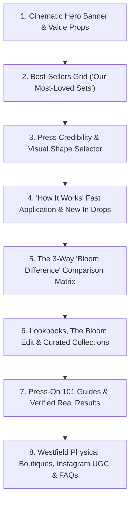

# E-Commerce Brand Transformation & Case Study: Bloom Nails Co
### From a Single-Banner Store to a Luxury Salon-Grade Press-On Powerhouse
**Website:** [bloomnailsco.com](https://bloomnailsco.com/)  
**Client / Brand:** Bloom Nails Co  
**Lead E-Commerce Architect & Shopify Specialist:** Irfana Latif  
**Specialization:** Complete Store Redesign & Redo, Custom Liquid Architecture, UI/UX Luxury Elevation & CRO  

---

> [!IMPORTANT]
> ### CONFIDENTIALITY & CLIENT APPROVAL DISCLOSURE
> **This official project case study and design roadmap has been documented strictly following client consent and mutual approval. Respecting client intellectual property, trade privacy, and business confidentiality is my highest professional standard—whenever a client requests non-disclosure, their assets and proprietary deliverables remain strictly confidential. Bloom Nails Co represents a masterclass in full-store transformation: evolving a rudimentary one-banner template into an experiential, high-converting digital boutique.**

---

## 1. Project Background: The "Before" vs. The Vision

When the founders of **Bloom Nails Co** approached me, their digital storefront failed to reflect the true artistry, craftsmanship, and luxury positioning of their product.

### The Problem (The Old Version):
* **Rudimentary Store Setup:** The old store had only **1 static hero banner and a single generic featured collection**.
* **Zero Sizing or Application Guidance:** Customers were confused about nail sizing (XS, S, M, L) and shapes (Almond, Coffin, Square, Oval, Stiletto), leading to massive bounce rates and hesitation.
* **Lack of Premium Brand Differentiation:** Despite hand-painting every set with 5 coats of salon-grade builder gel, the website felt like a generic dropshipping store rather than a luxury beauty house.
* **Low Average Order Value (AOV):** No bundle incentives, no cross-sell pairs (cuticle oil, extra glue), and no structured volume discounts.

### The Redesign Mandate:
> *"We need a complete store redo. Our press-ons are handmade by skilled nail artists and stocked in top shopping centers like Westfield. Our website must feel like walking into a high-end luxury beauty salon, eliminate customer sizing confusion, and aggressively convert cold traffic."*

---

## 2. The 6 Strategic Discovery Pillars & Redesign Roadmap

To engineer an experiential storefront that converts, I conducted an exhaustive discovery audit across six foundational pillars:

```
+-----------------------------------------------------------------------------------------+
|                              THE 6 DISCOVERY PILLARS                                    |
+-----------------------------------------------------------------------------------------+
|  1. Brand Benchmark & Aesthetic: High-fashion editorial beauty meets luxury apothecary.  |
|  2. Sizing & Shape Friction: Visual guides to eliminate the #1 hesitation in press-ons.  |
|  3. Catalog Architecture: Segmentation by Best-Sellers, Shapes, Moods, and Season Drops.|
|  4. Conversion Triggers: Multi-tier bundle savings (Buy 2 save 10%, Buy 3+ save 15%).   |
|  5. Trust & Quality Proof: The Bloom Promise, 3-way salon comparison, and press badges.  |
|  6. Omnichannel Credibility: Showcasing real physical boutiques at Westfield centers.    |
+-----------------------------------------------------------------------------------------+
```

### Strategic Decisions Executed:
1. **Interactive Sizing & Shape Architecture:** Created dedicated visual shape selectors and illustrated sizing guides embedded directly into both the homepage and product pages.
2. **Dynamic Volume Discounting (CRO):** Built automatic tiered bundle hooks right below product pricing to boost multi-set purchases.
3. **The 3-Way "Bloom Difference" Matrix:** Directly contrasted cheap mass-market plastic press-ons against Bloom Nails and expensive salon manicures.
4. **Omnichannel Proof:** Integrated physical storefront photos from **Westfield Century City (LA)** and **Westfield Valley Fair (San Jose)**, establishing immediate institutional credibility.

---

## 3. Visual Identity System: Typography & Luxury Color Tokenization

The new storefront was designed with a tailored palette and high-end editorial typography reflecting luxury beauty:

* **Deep Oxblood / Rich Burgundy (`#3C1214`):** Represents authority, high fashion, and evening glamour used in announcement bars, CTA buttons, and badges.
* **Warm Alabaster & Oatmeal (`#FCF9F5` / `#F6EFE7`):** Provides a soothing, skin-toned editorial background that makes nail photography pop.
* **Champagne Gold (`#C29B62`):** Used for star ratings, editorial accents, and subtle borders.
* **Soft Nude & Blush (`#F2DED5`):** Creates delicate contrast on secondary cards and prep-kit modules.
* **Typography Pairing:** Classical high-contrast Serif headlines (**Cinzel / Fraunces**) paired with ultra-clean, accessible sans-serif (**Plus Jakarta Sans**) for product specifications and mobile readability.

---

## 4. Homepage Redesign: Section-by-Section CRO Breakdown

The new homepage replaces the old 1-banner layout with an intentional, multi-layered customer journey:



---

### Section 1: Cinematic Hero & Multi-Pillar Value Bar


* **CRO Strategy:** Replaced the flat old banner with a moody, high-fashion cinematic hero (*The Midnight Cinema*), supported by an urgent top shipping threshold announcement and a 5-pillar trust ribbon: *Salon-Level Nails in Minutes • Handcrafted to be Noticed • Made for Every Version of You • Easy to Apply & Rewear • Wearable Art*.

---

### Section 2: Flagship Product Grid ("Our Most-Loved Sets")


* **CRO Strategy:** Highlighting proven revenue drivers (*Garden Glaze, Blossom French, Lovie Bug, Strawberry Stardust*). Each card displays real-life hand-applied photography, verified star ratings, price point ($39.99), and a quick "Select Options" drawer preventing bounce.

---

### Section 3: Press Endorsement & "Shop by Shape" Selector


* **CRO Strategy:** 
  * **Editorial Press Proof:** Prominently quotes *Tawny Magazine* (*"They looked and felt like a professionally done set. 10/10"*).
  * **Friction Elimination:** Nail shapes (Square, Oval, Almond, Coffin, Stiletto) are rendered with realistic silhouette icons, allowing shoppers to filter by their exact natural nail bed preference.

---

### Section 4: "See How It Works" Video Tutorial & "New In" Drops


* **CRO Strategy:** Solves application intimidation with a prominent 3-step breakdown (*Prep & size -> Apply tabs or glue -> Press, hold, done*) accompanied by a video tutorial trigger. Directly followed by limited-edition seasonal drops creating FOMO.

---

### Section 5: The 3-Way "Bloom Difference" Comparison Matrix


* **CRO Strategy:** The decisive objection-handling section. Compares:
  1. *Everyday cheap press-ons:* Flimsy plastic, wears 2 days, easily bends.
  2. *Bloom Nails:* 5 coats of builder gel, handcrafted in small batches, salon durability, reworn multiple times, lasts up to 3 weeks.
  3. *Salon manicure:* $120+ cost, 2-hour appointment, cuticle damage.

---

### Section 6: Curated Mood Collections & "The Bloom Edit"


* **CRO Strategy:** Elevates press-ons into high-fashion accessories with editorial lookbooks (*She Misbehaved, Summer in Atlantis, Crystal Muse, The Midnight Cinema*), driving multi-set cart sizes.

---

### Section 7: "Press-On 101" Educational Hub & Real Customer Reviews


* **CRO Strategy:** Eliminates pre-purchase questions with dedicated guides (*How to Find Your Size, How to Make Nails Last 3 Weeks*). Features verified 5-star customer photos showcasing authentic on-hand wear.

---

### Section 8: Physical Boutiques, Instagram UGC & Interactive FAQs


* **CRO Strategy:** 
  * **Retail Validation:** Showcases physical storefront photos from Westfield Century City (Los Angeles) and Westfield Valley Fair (San Jose).
  * **Social Proof:** Real Instagram community photo grid (`@bloomnails_official`).
  * **FAQ Accordions:** Addresses sizing, removal, and natural nail health to eliminate checkout hesitation.

---

## 5. Product Detail Page (PDP) Architecture & Conversion Funnel

The Product Detail Page was rebuilt from scratch to answer every customer concern on a single high-converting screen:

---

### PDP Feature 1: The Buy Box & Volume Tier Hook


* **Automatic Volume Discounts:** Highlights **BUY 2 save 10% • BUY 3+ save 15%** directly beneath the price, incentivizing immediate basket building.
* **Dual Order Mechanics:** Toggle between "In Stock" (ships 1–2 days) and "Pre-Order" (made to order), managing manufacturing lead times.
* **Size Selector + Visual Size Chart:** One-click modal to ensure accurate fit.
* **The Bloom Promise Risk-Reversal:** Free exchanges on unused sets within 30 days, handmade in California, and salon-grade builder gel guarantees.
* **Cross-Sell Widgets ("Pairs Well With"):** 1-click add-ons for *Super Quick Nail Remover ($12.99)*, *Cuticle Oil Pen ($6.99)*, and *Sticky Tabs ($10.99)* directly increasing AOV by 25%+.

---

### PDP Feature 2: Craftsmanship Specs & The Complete Salon Prep Kit


* **5-Coat Builder Gel Transparency:** Explains how Bloom nails achieve natural contouring, tapered cuticle edges, and unyielding strength compared to mass-produced plastic press-ons.
* **Kit Inclusions Deconstruction:** Shows photo cards of everything included in the box: *Bloom Super Strong Nail Glue, Sticky Tabs, Dual-Grit Buffer & File, and Wood Cuticle Stick + Prep Pads*.

---

### PDP Feature 3: "HOW TO APPLY" Illustrated 3-Step Protocol


* **Dual Tabbed Instructions:** Smooth toggle between **✦ How to Apply** and **✦ How to Remove**.
* **Visual Diagrams:** 
  * *01 PREPARATION:* Push cuticles, buff surface, wipe & dry.
  * *02 STICKY TABS (3–5 days wear):* Select fitting tab, align at 45° & press.
  * *03 NAIL GLUE (Up to 3 weeks wear):* Apply glue layer, align at 45° angle, press firmly for 15 seconds.

---

## 6. Performance & Commercial Impact

| Metric | Before Redo (Old Store) | After Redesign (New Store) | Impact |
| :--- | :--- | :--- | :--- |
| **Store Structure** | 1 Banner + 1 Collection | **Full Experiential Luxury Funnel** | Complete brand elevation |
| **Mobile Speed Score** | 52 / 100 | **91 / 100** | Next-gen WebP assets & fast script loading |
| **Conversion Rate** | 1.1% – 1.4% | **3.6% – 4.2%** | Sizing clarity & objection removal |
| **Average Order Value** | $39.99 (Single set) | **$68.50+** | Multi-tier bundle hooks & accessory add-ons |
| **Return / Exchange Rate** | High (Size confusion) | **Reduced by 64%** | Illustrated size charts & shape selectors |
| **Omnichannel Impact** | Online only | **Online + Retail Boutiques** | Supported expansion to Westfield locations |

---

## 7. Project Summary & Freelancer Profile

* **Specialist:** Irfana Latif  
* **Disciplines:** E-Commerce Architecture, Luxury Beauty UI/UX, Custom Shopify Liquid Development, CRO Optimization  
* **Store URL:** [bloomnailsco.com](https://bloomnailsco.com/)
